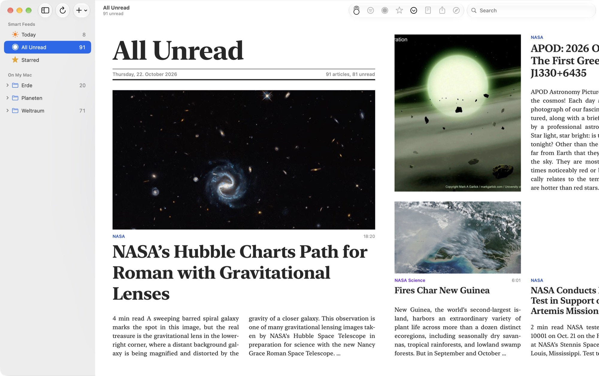
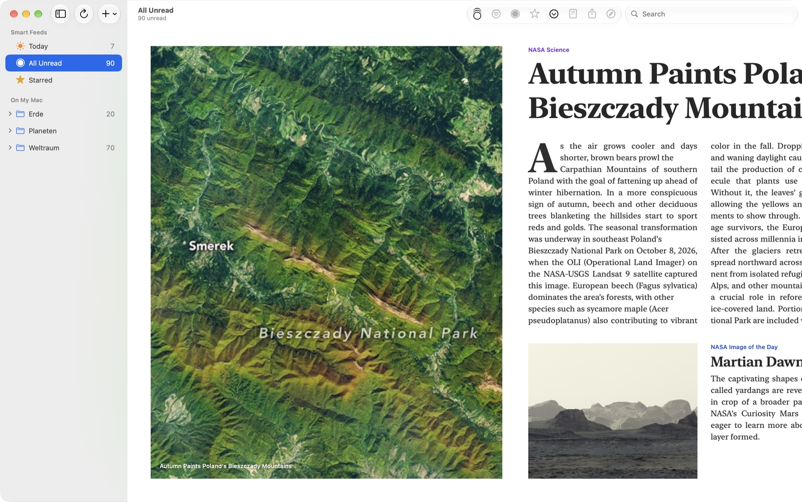
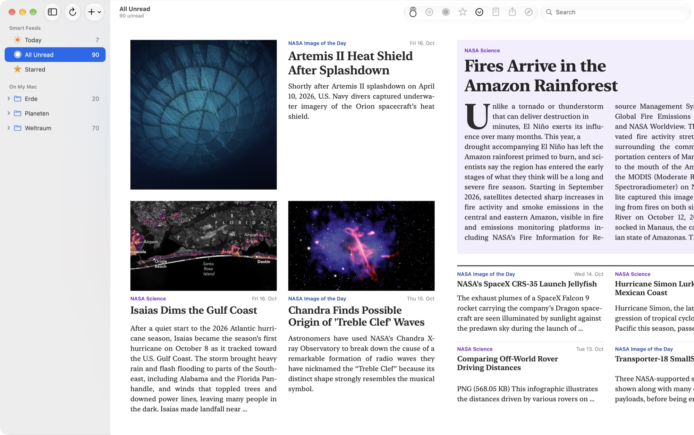
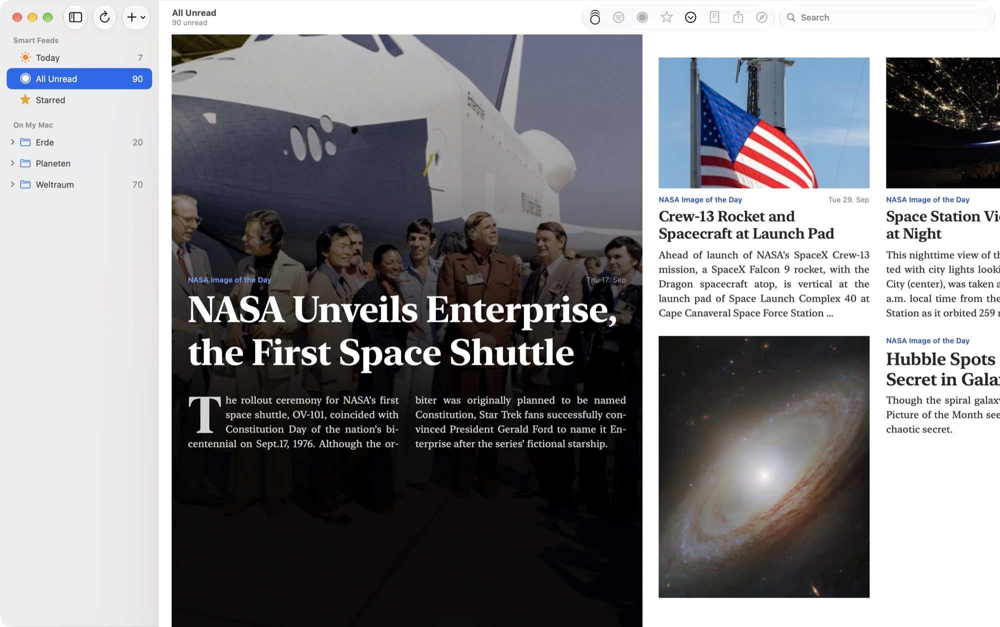
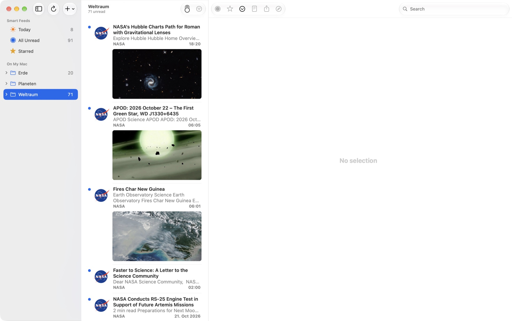
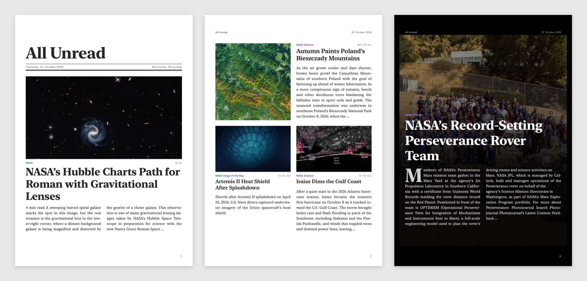

# RSS Feed Magazine

RSS Feed Magazine is a personal fork of [NetNewsWire](https://github.com/Ranchero-Software/NetNewsWire) for the Mac that shows article images, in the timeline and in a new magazine layout.



It’s a personal fork, not a replacement: NetNewsWire is a wonderful feed reader, and its makers plan their own take on images ([#1551](https://github.com/Ranchero-Software/NetNewsWire/issues/1551)). This fork goes its own way in the meantime. The story behind it (in German): [Mein NetNewsWire-Fork liest sich jetzt wie ein Magazin](https://www.wiredframe.de/blog/netnewsfeed/).

## What’s different

**Magazine layout** (View > Use Magazine Layout, on by default). Instead of a timeline and an article view, one surface that scrolls sideways and reads like a printed magazine: a fixed grid, templates that alternate (front page, newspaper page, photo page, black page, briefs), headlines in New York, body text in columns with justification, hyphenation, drop caps, and a shared baseline grid. Each folder is a section with its own color, which travels with its articles into All Unread and Today. Clicking an article marks it read and opens it in the browser.







**Images in the timeline** (View > Show Images in Timeline). Each article gets its image below the text, 16:9, with Mail-style separators between rows. Images are scaled to 960 pixels and cached with a 64 MB memory and 200 MB disk limit.



**Images from where feeds really put them.** Many feeds carry their article image only in Media RSS (`media:content`, `media:thumbnail`), as an image enclosure, or, like BR24, in the ARD’s metaplus module. The parser reads all of them and keeps the widest image.

**PDF export** (File > Export Magazine as PDF…). The magazine as an A4 PDF: one block per page, running head, page numbers, every article linked. Text stays text.



**Smaller things.** Folders show read articles too (View > Show Read Articles in Folders). Views show the newest 100 articles (View > Articles per View). Read articles in the magazine can fade (View > Fade Read Articles in Magazine, off by default).

## What’s not there

RSS Feed Magazine has its own name, icon, user agent, Developer ID signature, and bundle ID (`de.wiredframe.RSSFeedMagazine`), so it isn’t mistaken for NetNewsWire and runs next to it with separate data. That means:

- No iCloud sync, no Feedly, no Inoreader, and no Reader view: they need Ranchero’s entitlements or API keys. On My Mac, Feedbin, FreshRSS and the other services work.
- No Sparkle updates and no crash reports to netnewswire.com. Updates come through Homebrew.
- Mac only. The iOS app is untouched.

## Install

```
brew install --cask wiredframe/tap/rss-feed-magazine
```

Or download the zip from [Releases](https://github.com/Wiredframe/rss-feed-magazine/releases). Apple Silicon, macOS 15 or later. The app is signed but not notarized: the first time, open it with right-click > Open.

To move your subscriptions over, use File > Export Subscriptions… in NetNewsWire and File > Import Subscriptions… in RSS Feed Magazine.

## Build

```
./buildscripts/rss-feed-magazine.sh            # Release build into build/
./buildscripts/rss-feed-magazine.sh --install  # and copy to ~/Applications
./buildscripts/rss-feed-magazine.sh --zip      # and zip for a release
```

Signing is set in `xcconfig/common/NetNewsWire_codesigning_common.xcconfig`; change the team for your own builds.

## Credits

NetNewsWire is by Brent Simmons and contributors, MIT licensed; so is this fork. The changes were written with the help of an LLM (Claude), as every commit says. Screenshots show public-domain NASA feeds.

The original README is in [README-NetNewsWire.md](README-NetNewsWire.md).
